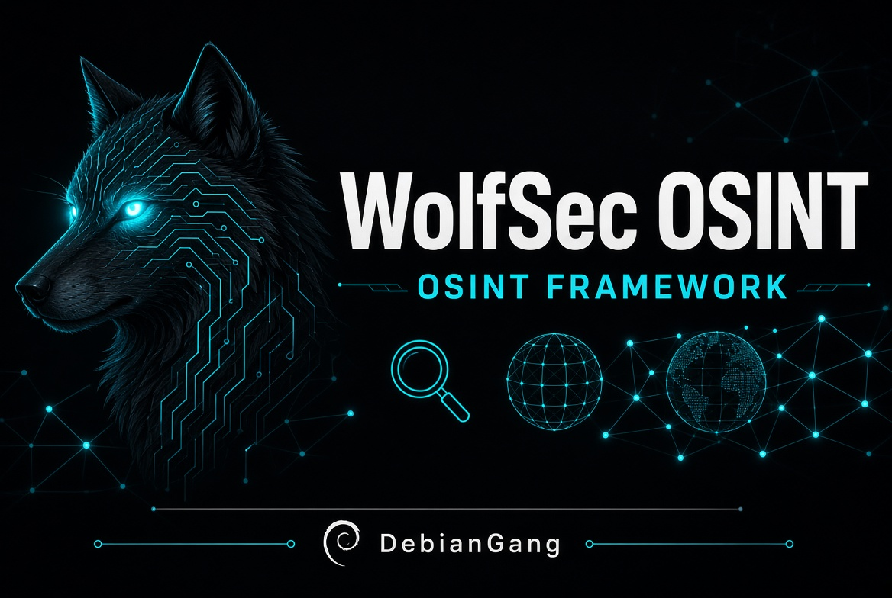

# WolfSec OSINT Framework

<p align="center">
  
</p>

**DebianGang / WolfSec Edition** — A practical, free, passive OSINT toolkit inspired by the classic OSINT Framework mindmap.


## Features

- **Domain Investigation** — WHOIS, full DNS records, Certificate Transparency subdomains (crt.sh)
- **IP Investigation** — Geolocation, ISP/AS, open ports, known vulnerabilities, tags, CPEs (Shodan InternetDB — no API key)
- **Username Search** — Heuristic checks across 12 major platforms
- **Email Basics** — MX records + Gravatar
- **Streamlit Web UI** + CLI mode
- **JSON export** of investigation results
- Purely passive, free sources only

## Quick Start (Python)

```bash
git clone https://github.com/masterxhackerx420-oss/WolfSec-OSINT.git
cd WolfSec-OSINT
pip install -r requirements.txt
streamlit run wolfsec_osint.py
```

Or run as a module:
```bash
python wolfsec_osint.py
```

## Standalone Executable

Pre-built executables (when available) can be found in the Releases section.  
To build your own:

```bash
pip install pyinstaller
pyinstaller --onefile --name WolfSec-OSINT wolfsec_osint.py
```

The binary will appear in the `dist/` folder.

## Usage

1. Launch the tool (web UI preferred).
2. Choose a tab: Domain, IP Address, Username, or Email.
3. Enter the target and click Investigate.
4. Export results as JSON if needed.

## Legal & Ethical Use

**For authorized research, journalism, and defensive security only.**  
Do not use this tool to harass, stalk, dox, or access systems without permission.  
The authors and DebianGang/WolfSec are not responsible for misuse.

## Recommended Full-Power Tools

For deeper coverage of the full OSINT Framework:
- [SpiderFoot](https://github.com/smicallef/spiderfoot) (200+ modules)
- [Sherlock](https://github.com/sherlock-project/sherlock) / Maigret
- [theHarvester](https://github.com/laramies/theHarvester)
- Official directory: [osintframework.com](https://osintframework.com)

## License

MIT — see LICENSE file.

---

Built for the DebianGang / WolfSec community.  
Stay curious. Stay ethical.
